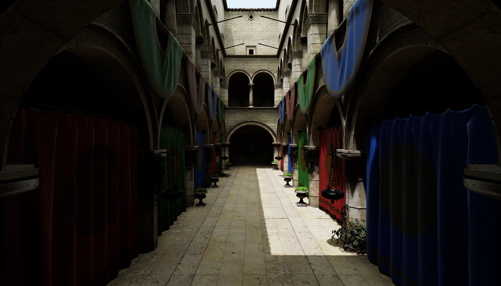
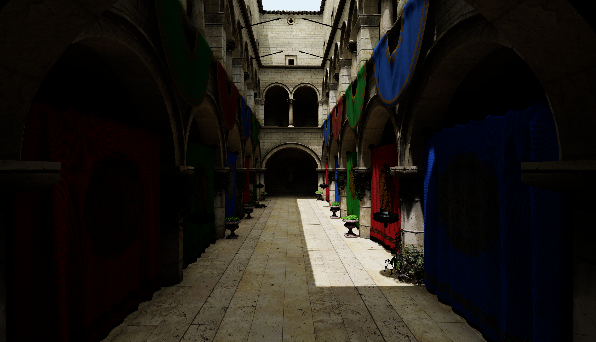
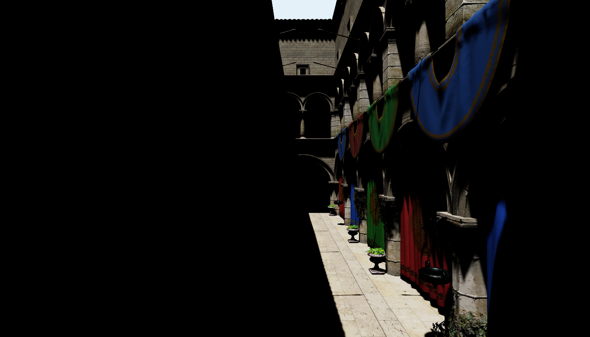
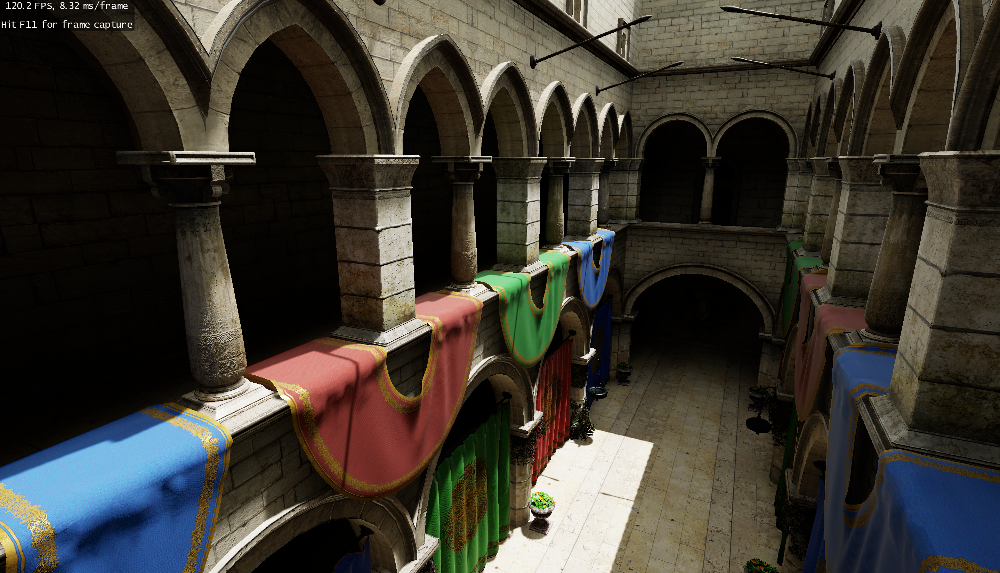
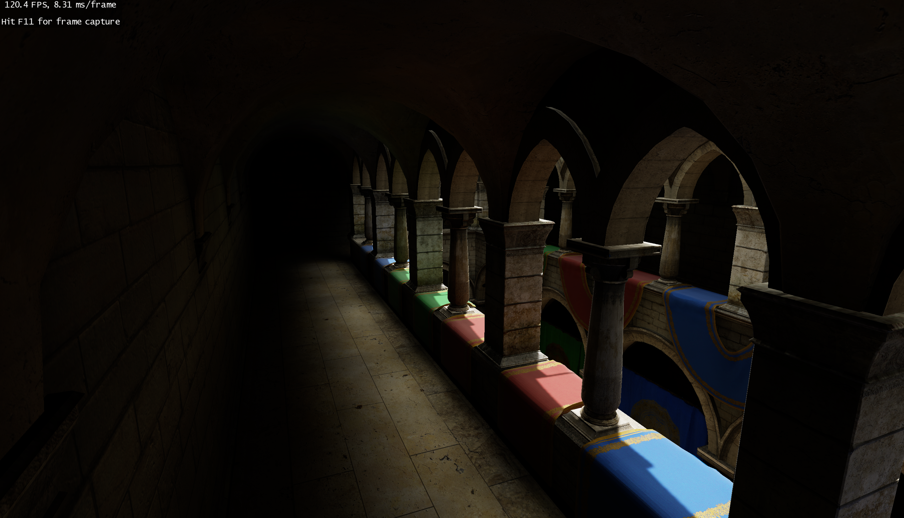
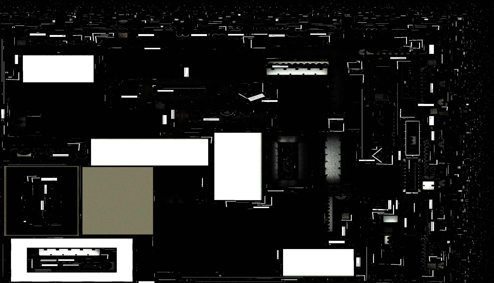

# Directional Light Map Baker

**Summary**: A hybrid renderer that uses a diffuse path-tracer to store irradiance for an entire scene using a 2D unwrapped texture and swaps to a rasterizer to display resulting scene with global illumination for diffuse surfaces.

Unlike most light maps, the "directional" light map generated also stores a low degree approximation of incoming radiance at each texel using spherical harmonics allowing for lightmaps to interact with normal maps and generate rough specularities for diffuse surfaces.

**Goal**: Path trace complex lighting as a one-time pre-processing step to render global illumination and view-depedent lighting in a real time using a rasterizer.

## Renders

Model used: Krhonos-Sponza

This is not my model, but it can be accessed here: https://github.com/KhronosGroup/glTF-Sample-Assets/tree/main/Models/Sponza

### With Global Illumination using Directional Lightmap

How the engine currently renders lightmap including view-depedent effects such as lightmap interacting with normal-maps and creating specularities.



### Same Global Illumination Scene with Non-Directional Lightmap 

When the engine's spherical harmonic approximation is ignored:



### Same Scene with No Lightmap (Direct Lighting)

When only direct lighting is computed and the path tracer's output is ignored:




## Performance

As you might expect, once the lightmap is finished, the rasterizer no longer needs to compute global illumination, so the real-time performance hits the cap frame-rate determined by v-sync on my laptop with a mobile RTX-4060.

We can even increase the light intensity to see that indirect lighting can bleed colors from the flags onto the corridor.






## The Lightmap

Each run of the engine runs the path tracer, and the results are updated in realtime for every surface in the scene. 

The lightmap baker can appear to be slow when compared to ray tracing from the camera view, but it's generating rays from every surface instead of from every pixel on screen. In Khronos-Sponza, the scene is unwwrapped into a 5130x5126 texture which requires 26,296,380 paths (not including bounces) to be simulated per sample.

If the variance of between samples on the same pixel is small, the pixel will terminate early.

The surface is expected to be noisey for small sample counts, so a denoiser post-processes the lightmap.

### Khronos-Sponza Mid-Bake



## Render in a Nutshell

1. Load models and textures using assimp
2. Uv-unwrap model to flat lightmap texture
3. Generate Bvh from model using surface area heuristic.
4. Rasterize scene to lightmap
5. From lightmap compute indirect irradiance and spherical harmonic coefficients for each texel by running a diffuse path tracer using the scenes geometric normals.
6. Denoise lightmap
7. Generate shadow maps from light's perspective for direct lighting
8. Generate gbuffer of raster scene including lightmap data for each pixel
9. Perform typical rasterization shading each pixel using the direct lighting and shadow maps.
10. Add in the indirect global illumination data from the lightmap computing its contribution to diffuse and specular lighting under the effect of normal maps (shading normals).
11. Perform ACES tone-mapping and convert linear color back into sRGB for your display.

## Information On Gltf's Pbr Material Model:
https://www.khronos.org/gltf/pbr/

## Material Values/Textures
1. Vec3: Base Color
2. Vec3: Emmision Color (In Progress)
3. Vec3: Normal
4. Scalar: Metallness
5. Scalar: Roughness
6. Scalar: Ambient Occlusion
7. Scalar: Alpha Coverage (Alpha Mask Mode Only)

## Texture Format Conventions
1. Base Color: sRGB
2. Emmision Color: sRGB
3. Normal: RGB
4. Metallness: R
5. Roughness: G
6. Ambient Occlusion: B 
7. Alpha Coverage: R

Note: Textures may be embedded or stored as external file paths. 

## Image Based Lighting
Currently only supports images containing equirectangularly projected radiance values stored as .hdr or .rgbe files.

## Limitations 

1. Only tested on gltf/glb files. I am using Assimp for importing which supports many file types, and if you follow the correct texture packing conventions it *should* work, but I make no guarantee. 

2. No support for gltf/glb non-core extensions (such as transmission), because I haven't gotten around to it.

3. Exenstions used for light mapping and path tracing in OpenGL (At this point I'm moving to Vulkan instead of forcing these modern features into OpenGL):
    1. ARB_bindless_texture *(bindless textures)*
    2. NV_GPU_shader5 *(non-uniform bindless textures)*
    3. NV_conservative_raster *(don't skip any texels when rasterizing lightmap)*
4. No support for .exr image based lighting.

## Camera Controls

*Hint: It is just Minecraft*

WASD: Move in the horizontal plane

SHIFT: Move vertically downwards

SPACE: Move vertically upwards

MOUSE POSITION: Look around / change orientation

ESC: Terminate down window

*(The wierd one)* ALT: Toggles the display of cursor. When the cursor is displayed you can click outside of the window without moving the camera.


## Build Instructions

Run these commands from the project root.

```text
(*Reccomended*)
(Visual Studio 2022 Release)
cmake --preset vs2022 -DFETCHCONTENT_QUIET=OFF
cmake --build --preset vs-release --target SceneRasterizer

(Visual Studio 2022 Debug)
cmake --preset vs2022 -DFETCHCONTENT_QUIET=OFF
cmake --build --preset vs-debug --target SceneRasterizer

(Ninja Release)
cmake --preset ninja-release -DFETCHCONTENT_QUIET=OFF
cmake --build --preset ninja-release --target SceneRasterizer

(Ninja Debug)
cmake --preset ninja-debug -DFETCHCONTENT_QUIET=OFF
cmake --build --preset ninja-debug --target SceneRasterizer
```

Run the Visual Studio Release build from the project root:

```text
.\build\vs2022\Release\SceneRasterizer.exe SceneConfig.yaml
```

The config path is optional and defaults to `SceneConfig.yaml`